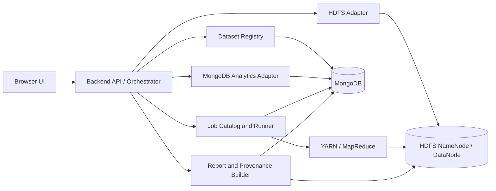
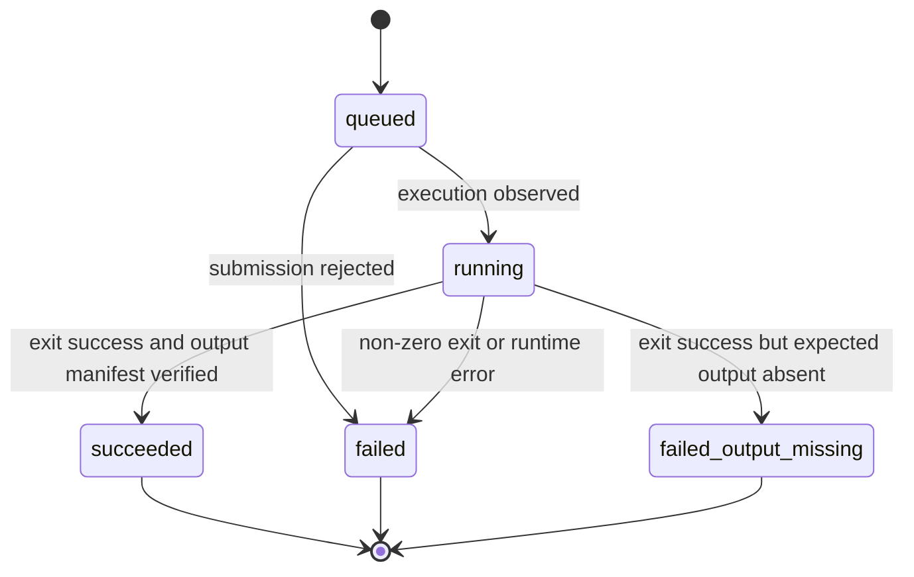

# DataDesk — Architecture and Technical Design

**Status:** Proposed architecture; not implemented  
**Related:** [PRD.md](PRD.md), [tasks.md](tasks.md), [design.md](design.md), [memory.md](memory.md), [rules.md](rules.md)

## 1. Architectural principles

1. Keep the system a modular monolith with one browser frontend and one backend API.
2. MongoDB stores metadata, small summaries, and run records; HDFS stores dataset bytes and batch outputs.
3. Hadoop MapReduce performs actual batch jobs. Do not simulate Hadoop results in application code.
4. Use a bounded job catalog, never arbitrary shell/JAR execution from the browser.
5. Treat dataset versions and run records as immutable evidence; corrections create new records.
6. Assume no transaction spans MongoDB and HDFS. Use explicit lifecycle states, idempotent operations, and reconciliation.
7. Treat a single-machine pseudo-distributed Hadoop setup as a teaching lab, not a distributed performance benchmark.

## 2. Component boundaries



### Frontend
- Dashboard, datasets, HDFS explorer, job catalog, run monitor, results, comparison, settings/about.
- Calls typed API endpoints; does not access MongoDB/HDFS directly.
- Never receives unrestricted shell or filesystem capabilities.

### Backend API / orchestration
- Validates requests and parameters, checks path ownership, coordinates lifecycle states, records audit events, and translates infrastructure failures into stable error codes.
- Runs one job at a time by default; configurable maximum concurrency is 1 for baseline measurements.
- Uses timeouts, bounded logs, and cancellation semantics.

### Dataset registry
- Computes SHA-256 from streamed bytes before finalization.
- Writes to a unique temporary HDFS path, verifies stored byte count/checksum when retrieval verification is supported, then atomically finalizes the metadata state as far as cross-system semantics allow.
- Creates immutable dataset-version records and maintains a current-version pointer on the logical dataset record.

### HDFS adapter
- Single interface around Hadoop filesystem operations.
- Restricts all application-managed paths to `/datadesk/`.
- Exposes `mkdir`, `list`, `put`, `get`, `stat`, `checksum`, and guarded `delete` operations.
- Uses process argument arrays or a supported Hadoop client library; never concatenates untrusted input into a shell command.

### Job catalog and runner
- Static registry of job IDs, code versions, input schemas, parameter schemas, validation rules, output schemas, and canonicalization rules.
- Creates a unique output directory for every attempt.
- Invokes `hadoop jar` or the job entry point inside the Hadoop container using a fixed command template and validated arguments.
- Polls job/application status and records logs, exit code, times, and output manifest.

### MongoDB analytics adapter
- Executes approved aggregation pipelines using the supported aggregation API.
- Uses equivalent parsing, filtering, null handling, and invalid-row policies to the MapReduce job.
- Does not use MongoDB's deprecated MapReduce API; MongoDB documentation states it was deprecated starting in MongoDB 5.0 [M2].

### Provenance/report builder
- Joins immutable dataset version, job definition version, run configuration, runtime versions, logs, output path, output checksum/manifest, and normalized result summary.
- Exports JSON manifest and human-readable CSV/HTML or PDF report; PDF is optional if it adds too much dependency burden.

## 3. Proposed API surface

All endpoints are local-only. Request and response bodies are JSON unless file streaming is stated. Exact route names may change only through a documented decision.

| Method / route | Purpose | Guardrails |
|---|---|---|
| `GET /api/health` | Infrastructure readiness | Report component status without secrets. |
| `GET /api/datasets` | List logical datasets and versions | Paginated, bounded results. |
| `POST /api/datasets` | Begin streamed upload/registration | Enforce size, format, checksum, and temp-path policy. |
| `GET /api/datasets/{id}` | Metadata and version lineage | Validate IDs; no arbitrary path input. |
| `GET /api/datasets/{id}/versions/{version}` | Exact immutable version | Return checksum and HDFS path. |
| `DELETE /api/datasets/{id}/versions/{version}` | Request deletion | Confirmation token/explicit body; ownership and dependency checks. |
| `GET /api/hdfs?path=...` | List managed directory | Normalize path and enforce prefix. |
| `POST /api/hdfs/directories` | Create managed directory | Parent must be under `/datadesk/`. |
| `POST /api/hdfs/files` | Add/import file | Upload limit and safe name. |
| `GET /api/hdfs/files/{fileId}/download` | Retrieve file | Resolve stored managed path from ID, not raw user path. |
| `DELETE /api/hdfs/entries/{entryId}` | Delete managed entry | Preview, confirmation, no root or unowned path. |
| `GET /api/jobs` | List approved job definitions | Read-only catalog. |
| `POST /api/runs` | Validate and submit job | Dataset version ID + job ID/version + typed parameters. |
| `GET /api/runs/{runId}` | Status, details, provenance | Paginated/truncated logs. |
| `POST /api/runs/{runId}/reproduce` | Create new run from recorded config | Never mutate old run. |
| `POST /api/comparisons` | Run equivalent MongoDB analysis | Same dataset version and semantic policy. |
| `GET /api/reports/{runId}` | Download report/manifest | Only complete reports for known run IDs. |

## 4. Data model

Use MongoDB collections with schema validation where practical. Store large raw files and large result files in HDFS, not as giant MongoDB documents. Keep individual metadata documents comfortably below MongoDB's BSON document size limit.

### `datasets`
```json
{
  "_id": "ds_<uuid>",
  "displayName": "Retail events",
  "description": "Deterministic synthetic fixture",
  "createdAt": "ISO-8601 UTC",
  "latestVersionId": "dsv_<uuid>",
  "tags": ["synthetic", "demo"],
  "lifecycleStatus": "active"
}
```

### `dataset_versions`
```json
{
  "_id": "dsv_<uuid>",
  "datasetId": "ds_<uuid>",
  "versionNumber": 1,
  "originalFilename": "events.csv",
  "format": "csv",
  "mediaType": "text/csv",
  "byteSize": 12345,
  "sha256": "hex-digest",
  "recordCount": 1000,
  "hdfsPath": "/datadesk/datasets/ds_<uuid>/v1/data.csv",
  "createdAt": "ISO-8601 UTC",
  "lifecycleStatus": "stored",
  "validation": {"acceptedRows": 998, "rejectedRows": 2, "policyVersion": "csv-v1"},
  "source": {"kind": "synthetic", "licenseUrl": null}
}
```

### `job_definitions`
```json
{
  "_id": "group-count",
  "version": 1,
  "displayName": "Grouped count",
  "entryPoint": "org.datadesk.jobs.GroupCountJob",
  "inputFormats": ["csv", "jsonl"],
  "parameterSchema": {"groupField": "allowlisted-field-name"},
  "outputSchemaVersion": "group-count-v1",
  "codeRevision": "git-commit-sha"
}
```

### `runs`
```json
{
  "_id": "run_<uuid>",
  "datasetVersionId": "dsv_<uuid>",
  "datasetSha256": "hex-digest",
  "jobDefinitionId": "group-count",
  "jobDefinitionVersion": 1,
  "parameters": {"groupField": "category"},
  "configFingerprint": "sha256-canonical-json",
  "runtime": {"hadoopVersion": "verified-at-build", "javaVersion": "verified-at-build", "imageDigest": "sha256:..."},
  "status": "queued",
  "submittedAt": "ISO-8601 UTC",
  "startedAt": null,
  "finishedAt": null,
  "applicationId": null,
  "outputPath": "/datadesk/runs/run_<uuid>/output",
  "outputManifest": null,
  "metrics": {"elapsedMs": null, "outputBytes": null, "cpuSeconds": null, "peakMemoryBytes": null},
  "logReference": "bounded-log-id",
  "errorCode": null,
  "reproducesRunId": null
}
```

### `events`
Append-only lifecycle events: `eventId`, `entityType`, `entityId`, `eventType`, `occurredAt`, `correlationId`, `detailsSafe`, `actorKind` (local user/system). Never log file contents, credentials, or arbitrary unbounded stack traces.

### Indexes
- `dataset_versions`: unique `(datasetId, versionNumber)`, unique `sha256` only if deduplication semantics are global and intentional; otherwise non-unique checksum index.
- `runs`: `(datasetVersionId, submittedAt)`, `(status, submittedAt)`, `configFingerprint`.
- `events`: `(entityId, occurredAt)`.

## 5. HDFS namespace and lifecycle

```text
/datadesk/
  datasets/<dataset-id>/v<version>/data.<ext>
  runs/<run-id>/input/        # optional copied input; avoid unnecessary duplicate storage
  runs/<run-id>/output/       # Hadoop output directory, unique per run
  staging/uploads/<upload-id>/
  quarantine/<run-id>/         # failed output retained temporarily for diagnosis
```

The app does not expose HDFS paths outside `/datadesk/`. HDFS output paths must not exist before job submission. Never use an output directory supplied verbatim by a browser request.

### Upload state machine

```mermaid
stateDiagram-v2
  [*] --> pending_upload
  pending_upload --> stored: bytes verified and metadata finalized
  pending_upload --> failed: transfer/validation error
  failed --> pending_upload: explicit retry with new staging ID
  stored --> deleting: validated delete request
  deleting --> deleted: HDFS delete confirmed
  deleting --> stored: deletion failed; reconciliation required
```



### Run state machine



A run is successful only when the process exits successfully and required outputs exist and pass basic manifest checks.

## 6. Upload, execution, and deletion protocols

### Upload
1. Validate request, file size, allowed extension, and format parser.
2. Stream bytes to a unique local/container staging file while calculating SHA-256.
3. Check duplicate policy and create a `pending_upload` record.
4. Upload to a unique HDFS staging path; verify stored bytes/checksum when possible.
5. Move/rename to immutable version path; finalize metadata as `stored`.
6. On failure, preserve enough state for reconciliation; remove only known temporary paths.

### Run
1. Validate dataset version is `stored`; verify its expected HDFS path exists.
2. Validate job ID/version and typed parameters against static catalog.
3. Canonicalize configuration and calculate fingerprint.
4. Insert `queued` run record and allocate unique output path.
5. Execute fixed Hadoop command template; collect application ID/status/logs/timing.
6. Verify output exists, compute output manifest/checksum, and record metrics.
7. Mark `succeeded` only after verification; otherwise record failure state.

### Deletion
1. Preview exact target, size/count estimate if available, and dependent runs.
2. Reject `/`, `/datadesk`, dataset roots not owned by DataDesk, and any path outside the managed prefix.
3. Transition metadata to `deleting`; perform deletion only through HDFS adapter.
4. Finalize `deleted` after confirmation; if failure occurs, keep a repairable state.
5. Startup reconciliation scans only DataDesk-managed lifecycle records and known staging paths.

## 7. Deployment proposal and version policy

### Baseline topology
- Windows 11 or supported Windows 10 host, VS Code, Docker Desktop using WSL 2 Linux containers.
- One Compose project with MongoDB, a Hadoop single-machine teaching deployment, and backend/frontend containers.
- Hadoop may be represented as a single pseudo-distributed container with NameNode, DataNode, ResourceManager, and NodeManager for the simplest first build; if a maintained image does not support this cleanly, use a small set of containers. Avoid pretending these containers form independent physical nodes.
- Keep persistent Docker volumes for MongoDB and HDFS data; provide explicit reset scripts that warn before deleting them.
- Bind-mount source code from the WSL Linux filesystem where practical; avoid high-volume builds on `/mnt/c` if filesystem performance becomes a bottleneck.

### Version candidates (must be pinned after compatibility smoke tests)
- Hadoop **3.5.0**: official Apache release page identifies it as the first stable 3.5 line release, dated 2026-04-02; server side requires Java 17, client supports Java 17/21 [H1, H2]. Image `apache/hadoop:3.5.0` smoke-tested on 2026-10-26 (digest sha256:46980ea1653eb3453d9cf43c4b7cb69c4729e19612d4902da0372d11e11a7a12).
- MongoDB Community Server **7**: official `mongo:7` image smoke-tested on 2026-10-26 (digest sha256:c53852c00c23ca9f23fc39690350ffa9a80e3642fe8f96879726d8da0abe80a7); insert/read/delete verified. Pin exact tag/digest. Use aggregation pipeline, not legacy MapReduce [M1].
- Docker Desktop: current supported release on Windows with WSL 2; official docs list WSL 2.1.5 minimum and 8 GB RAM minimum, with virtualization enabled [W1, W2]. Docker Compose orchestrates local services (MongoDB, Hadoop, backend).
- Java: align with selected Hadoop release (Java 17 for Hadoop 3.5.0 server-side requirement) [H1]. Smoke-tested image `apache/hadoop:3.5.0` runs Java 17.0.18.
- Backend: **Node.js 22 LTS + TypeScript**, **Express 5** REST API, official **MongoDB Node.js driver**; **Vitest + Supertest** for tests. Phase 1 ingestion code exists locally under `packages/backend/` but is **untracked and uncommitted** (not on `origin/phase-1/backend-dataset-ingestion` HEAD `038c409`). Exact pins in `packages/backend/package.json` + `package-lock.json` (Express 5.3.0, mongodb 7.7.0, TypeScript 5.9.3, Vitest 5.0.5, Supertest 7.3.1). Test results (`tsc --noEmit`, `npm test`, `npm audit`) are **reported**, not independently reproduced in this checkout; `node_modules` is absent so they cannot be run from a clean tree without `npm ci`. Express 5 service smoke-tested 2026-10-26 as a disposable service only (`GET /api/health` → `HTTP/1.1 200 OK`, bound to `127.0.0.1`); DataDesk application integration itself is not live-service tested. Duplicate detection is enforced by an atomic MongoDB dedup-claims collection keyed by `sha256:byteSize`; the existing non-unique `dataset_versions.sha256` checksum index per §4 is preserved. Startup reconciliation repairs interrupted `pending_upload` versions. One backend only; no microservices, Redis, Kafka, Kubernetes, or unnecessary ORM.
- WebHDFS: proposed HDFS client, **verified by test 2026-10-26** (upload + byte/checksum confirmation PASS via WebHDFS HTTP API; see `memory.md` §8e). Caveats: image ships with empty `core-site.xml`/`hdfs-site.xml`, so `fs.defaultFS`, `dfs.namenode.http-address`, and `dfs.webhdfs.enabled=true` must be configured before the NameNode starts; the backend must pass `?user.name=hadoop` (or run as `hadoop`) for write permission; CREATE/OPEN redirects target the datanode by container hostname. The Hadoop CLI adapter remains the smoke-tested fallback.

**Do not claim all components are compatible merely because each is current.** The Phase 4 gate requires a clean-image smoke test: MongoDB health, HDFS put/get/delete, YARN job submission, and MapReduce output retrieval. Record image digests and licenses.

### Stack constraints (lightweight baseline)
- One backend service only; no microservices.
- No Redis, Kafka, or Kubernetes.
- No ORM; the official MongoDB Node.js driver is the data-access layer.
- The backend is the only layer allowed to orchestrate MongoDB/HDFS/Hadoop operations (rules.md §5).
- Pin dependencies and container images by exact version and preferably digest when implementation begins; never `latest`.

## 8. Security and safety controls

- Bind UI/API to loopback by default; no router port forwarding.
- No arbitrary shell or arbitrary JAR submission.
- Use allowlisted job IDs and typed, bounded parameters.
- Restrict paths to `/datadesk/`; normalize before checking; resolve IDs to server-side paths.
- Bound upload size, job duration, concurrency, log size, output size, and API pagination.
- Use generated IDs and sanitized display names; never trust the uploaded filename as a path.
- Avoid storing secrets in Compose files, logs, or the repository.
- Disable/avoid public unauthenticated Hadoop admin endpoints; expose admin UIs to localhost only.
- Pin container images by exact version and preferably digest; scan licenses and image origin before adoption.
- No production or hostile multi-user threat model is claimed.

## 9. Monitoring and metrics

For each run record wall-clock elapsed milliseconds, input bytes, output bytes, accepted/rejected records, process exit code, CPU and memory samples if measurable, and Hadoop counters when available. Clearly identify metrics unavailable from a chosen container/image. Local container CPU/memory measurements are not equivalent to cluster-wide resource consumption.

## 10. Decisions and unresolved architecture questions

| ID | Question | Default proposal | Consequence if unresolved |
|---|---|---|---|
| AD-01 | Available host RAM/CPU/disk? | Minimum 8 GB RAM to start; 16 GB preferred for smoother local stack; verify actual hardware before finalizing. | May require reducing services/data sizes or stop the project until resources are available. |
| AD-02 | Hadoop image choice and license? | Select after provenance, maintenance, architecture, and license review; pin digest. | Cannot finalize deployment or claim reproducible setup. |
| AD-03 | Backend language/framework? | **Proposed:** Node.js 22 LTS + TypeScript, Express 5 REST API, official MongoDB Node.js driver; Vitest + Supertest for tests. One backend; pin exact versions at implementation. | Express 5 service smoke-tested (HTTP 200 on GET /api/health, loopback-only); DataDesk application integration not implemented; directory layout and test commands remain provisional. |
| AD-04 | Public dataset? | Start with synthetic fixtures; select a public dataset only after terms, privacy, schema, and size review. | No public dataset should enter the baseline until reviewed. |
| AD-05 | Include Hive/Pig/Spark? | Optional extension only after core gates pass. | Does not block core acceptance. |
| AD-06 | Dataset deletion with dependent runs? | Block by default; require explicit retention override and explain that provenance may become incomplete. | Avoid silently invalidating old reports. |
| AD-07 | HDFS client: WebHDFS or Hadoop CLI? | WebHDFS confirmed by test 2026-10-26; configure `fs.defaultFS`/HTTP-bind/`dfs.webhdfs.enabled=true` and use `?user.name=hadoop` for writes; CLI adapter remains smoke-tested fallback. | Adapter implementation must address the config and datanode-redirect caveats before selecting WebHDFS. |

## 11. Architecture acceptance gate

A disposable clean environment must prove MongoDB readiness, HDFS mkdir/put/list/get/rm, a real Hadoop MapReduce job, output retrieval, and clean shutdown/restart persistence. Any chosen image incompatibility must be resolved before Phase 5 implementation begins.
