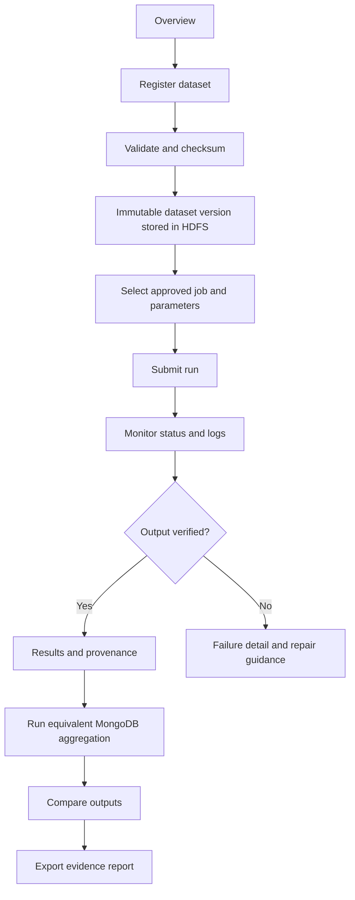

# DataDesk — UX and Visual Design Specification

**Status:** Proposed design; no frontend implementation has started.  
**Related:** [PRD.md](PRD.md), [Architecture.md](Architecture.md), [tasks.md](tasks.md), [memory.md](memory.md), [rules.md](rules.md)

## 1. Design intent

DataDesk should look like a calm, capable research workspace: compact navigation, clear hierarchy, useful tables, visible job state, and trustworthy evidence. Avoid faux operating-system chrome, excessive glass effects, dashboard clutter, or productivity-suite imitation. Data operations and traceability take priority over decoration.

## 2. Information architecture

Persistent left navigation:
- **Overview** — system readiness, recent runs, dataset count, quick-start checklist.
- **Datasets** — registry, versions, upload, validation summaries.
- **HDFS Explorer** — managed directory tree and file operations.
- **Jobs** — approved job catalog and parameter forms.
- **Runs** — status, logs, metrics, provenance, reproduction.
- **Compare** — MongoDB versus Hadoop output comparison.
- **Reports** — exportable run reports and manifests.
- **Help & System** — versions, setup diagnostics, limitations, reset controls.

## 3. Core screens

### Overview
- Service-health strip for API, MongoDB, HDFS, and YARN/MapReduce.
- Primary actions: Register dataset, Browse HDFS, Run analysis.
- Recent runs with explicit status text and links to evidence.
- Compact cards: stored dataset versions, successful/failed runs, storage bytes; no invented metrics.
- First-run checklist explains how to demonstrate both practical activities.

### Dataset registry
- Search/filter by name, format, status, created date, and tag.
- Table columns: name, format, bytes, record count, short SHA-256, version, HDFS state, created date.
- Upload dialog: file picker, display name, format detection, validation, duplicate warning, progress and cancel behavior.
- Dataset detail: immutable versions, checksum copy action, source/license note, row-validation counts, HDFS location, dependent runs.
- A new upload creates a new version; it never silently replaces an old version.

### HDFS Explorer
- Breadcrumb plus directory tree/list; show only `/datadesk/` managed paths.
- Columns: name, type, bytes, modified time if available, managed owner/status.
- Actions: New directory, Add file, Retrieve, Delete.
- Destructive dialog displays exact path and impact; recursive delete requires typing the final path or equivalent explicit confirmation.
- Error states distinguish missing path, permission/path-policy rejection, HDFS unavailable, and operation failure.

### Job catalog
- Cards/list for each approved job with purpose, input format, expected output, parameters, and MapReduce concepts demonstrated.
- Submission form requires exact dataset version, job version, and bounded parameters.
- Show the expected output schema and invalid-row policy before execution.
- No free-form command field or JAR upload.

### Run detail / monitor
- Lifecycle header: queued, running, succeeded, failed, failed output missing.
- Timeline: submitted, started, finished, output verified.
- Tabs: Summary, Output, Logs, Configuration, Provenance.
- Metrics include elapsed time, input/output bytes, records accepted/rejected, and CPU/memory only when measured.
- “Reproduce run” creates a new run; a confirmation explains which exact input version/configuration will be reused.
- Logs are bounded, text-only, and may be downloaded as a file.

### Results and comparison
- Summary values, sortable table, simple bar/line chart when appropriate, and accessible data-table alternative.
- Show expected versus actual record counts and mismatches.
- MongoDB/Hadoop comparison normalizes key order and documents numeric tolerance.
- Mismatch drill-down shows missing keys, differing values, and parsing-policy differences.
- Export buttons identify file format and include provenance manifest.

### Reports
- List report/run ID, dataset version, job version, status, creation date.
- Report body: experiment question, dataset checksum, config, runtime versions, metrics, output manifest, correctness result, limitations.
- Failed runs are exportable as failure reports and are not disguised as successful results.

### Help & System
- Version inventory and health details.
- Windows/WSL/Docker readiness checks and common fixes.
- Reset controls separated from normal operations; show volumes/paths affected and require confirmation.
- Plain-language note that a single-machine pseudo-distributed setup does not establish cluster-scale performance.

## 4. Main interaction flow

## 5. Responsive behavior

- Desktop-first because HDFS trees, logs, and result tables need width; target 1280 px and above for the full workspace.
- Tablet: collapse left navigation; use stacked metric cards; preserve table column priority and horizontal scrolling with a visible cue.
- Mobile: support status viewing, dataset metadata, and logs; complex upload/job configuration remains functional but uses a single-column form.
- No operation may become available only on hover.
- Long checksums and HDFS paths wrap or offer a copy control; do not force page-wide overflow.

## 6. Visual system

### Color roles
Use semantic tokens rather than scattered literal colors. Verify actual contrast in implementation before claiming WCAG compliance.
- `canvas`: neutral light background.
- `surface`: white/near-white content surfaces.
- `surface-muted`: subtle alternate rows and panels.
- `text-primary`: near-black, high contrast.
- `text-secondary`: subdued but AA-compliant text.
- `border`: neutral divider.
- `action`: accessible blue for primary actions and links.
- `success`: green paired with check icon and text.
- `warning`: amber paired with warning icon and text.
- `danger`: red paired with explicit wording and icon.
- `running`: blue/indigo with spinner and “Running” text.

### Typography
- Use a maintained system sans-serif stack.
- Clear hierarchy: page title, section title, body, metadata, code/log text.
- Use tabular numerals for metrics and monospaced text for checksums, paths, IDs, and configuration snippets.
- Avoid tiny text for secondary labels; target readable 14–16 px body sizing.

### Components
- Buttons: primary, secondary, quiet, destructive; minimum 44×44 CSS px hit target.
- Forms: persistent labels, inline constraints, explicit required markers, validation summary for submission errors.
- Tables: semantic headers, row focus, sorting labels, pagination, empty states.
- Status: icon + text + optional color; never color alone.
- Dialogs: accessible title, initial focus, Escape behavior when safe, focus trap, focus restoration.
- Notifications: non-blocking success messages; persistent inline errors for failures requiring action.
- Charts: labeled axes/units, readable contrast, concise legends, table fallback, no 3D charts.

## 7. Accessibility requirements

Target WCAG 2.2 AA; verify rather than assume.
- Full keyboard operation and logical focus order.
- Visible focus indicator not obscured by sticky headers/dialogs.
- Contrast checks for text and non-text controls/indicators.
- Semantic headings, landmarks, table headers, form labels, accessible names.
- Error messages identify the field and corrective action; do not rely on color.
- Reduced-motion preference respected; no required information conveyed by animation.
- Progress and run status announced accessibly without excessive live-region chatter.
- Charts have text summaries and equivalent data tables.
- Destructive action requires clear target/impact confirmation.
- Automated accessibility scans are supplementary; manually test keyboard and screen-reader flows.

## 8. States every screen must specify

- Initial/loading.
- Empty state with a relevant next action.
- Success with next step.
- Validation failure.
- Infrastructure unavailable.
- Permission/path-policy rejection.
- Partial completion/reconciliation pending.
- Long-running operation.
- Destructive confirmation and cancellation.

## 9. Content and tone

Use direct, operational language: “Dataset stored,” “Output verification failed,” “HDFS is unavailable,” “This path is outside DataDesk’s managed directory.” Avoid vague alerts such as “Something went wrong” without an error ID or next action.

## 10. Design acceptance gate

Before frontend implementation, a reviewer must be able to complete the core workflow from this specification. Keyboard paths, empty/error states, destructive confirmations, responsive table behavior, chart alternatives, and status semantics must be specified and later tested.
